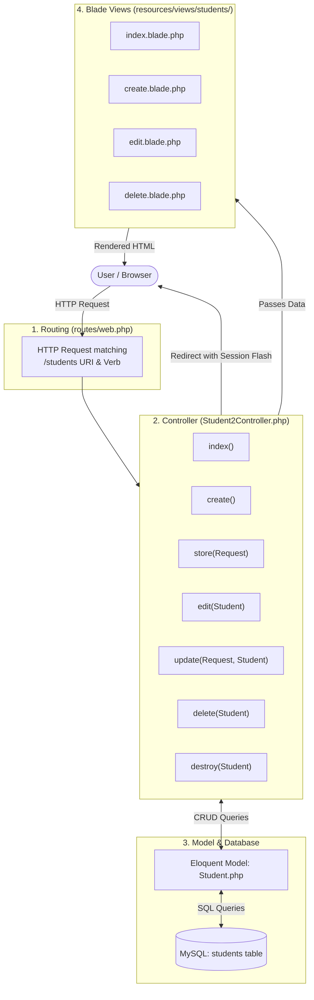
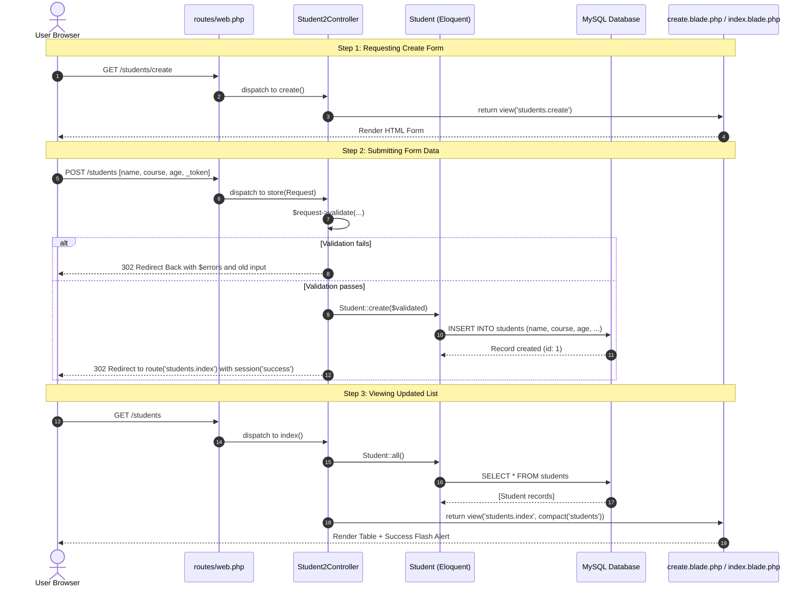

# Student Management System — Architecture & Workflow Guide

This document provides a comprehensive explanation of how the **Student Management System** works in this Laravel application, detailing the flow from HTTP requests and routes through the controller, model, database, and Blade views.

---

## 1. High-Level Architecture Overview

The application follows Laravel's **Model-View-Controller (MVC)** architectural pattern:



---

## 2. Database Schema & Migration

### Migration File: `database/migrations/2026_09_22_000008_create_students_table.php`

The database schema defines the structure of the `students` table in MySQL:

```php
Schema::create('students', function (Blueprint $table) {
    $table->id();             // Auto-incrementing primary key
    $table->string('name');   // Student full name (VARCHAR 255)
    $table->string('course'); // Course / Degree (VARCHAR 255)
    $table->integer('age');   // Student age (INT)
    $table->timestamps();     // created_at & updated_at timestamps
});
```

* **`id`**: Unique identifier for each student record.
* **`timestamps()`**: Automatically handled by Laravel Eloquent whenever a record is inserted or updated.

---

## 3. Eloquent Model

### Model File: `app/Models/Student.php`

```php
namespace App\Models;

use Illuminate\Database\Eloquent\Factories\HasFactory;
use Illuminate\Database\Eloquent\Model;

class Student extends Model
{
    use HasFactory;

    protected $fillable = [
        'name',
        'course',
        'age',
    ];
}
```

### Key Concept: Mass Assignment Protection
The `$fillable` array explicitly declares which database columns are allowed to be bulk-assigned via `Student::create($validated)` or `$student->update($validated)`. This prevents malicious users from injecting arbitrary data into unprotected database columns.

---

## 4. Routes Breakdown

### Route File: `routes/web.php`

All 7 endpoints are explicitly defined with named routes:

| HTTP Verb | URI | Controller Action | Route Name | Purpose |
| :--- | :--- | :--- | :--- | :--- |
| `GET` | `/students` | `Student2Controller@index` | `students.index` | View list of all students |
| `GET` | `/students/create` | `Student2Controller@create` | `students.create` | Show student creation form |
| `POST` | `/students` | `Student2Controller@store` | `students.store` | Validate and store new student |
| `GET` | `/students/{student}/edit` | `Student2Controller@edit` | `students.edit` | Show form to edit existing student |
| `PUT` | `/students/{student}` | `Student2Controller@update` | `students.update` | Validate and update existing student |
| `GET` | `/students/{student}/delete` | `Student2Controller@delete` | `students.delete` | Show delete confirmation screen |
| `DELETE` | `/students/{student}` | `Student2Controller@destroy` | `students.destroy` | Delete student from database |

### Route Model Binding
Parameters defined as `{student}` automatically trigger **Implicit Route Model Binding**:
- When a URL such as `/students/4/edit` is requested, Laravel reads the ID `4` from the route segment.
- It queries the database: `SELECT * FROM students WHERE id = 4 LIMIT 1;`.
- If found, it injects the `Student` object directly into the controller method parameter:
  ```php
  public function edit(Student $student)
  ```
- If the ID does not exist, Laravel automatically throws a `404 Not Found` response.

---

## 5. Controller Methods Deep Dive

### Controller File: `app/Http/Controllers/Student2Controller.php`

### 1. `index()` — Listing Students
```php
public function index()
{
    $students = Student::all();

    return view('students.index', compact('students'));
}
```
* **What it does:** Fetches all student records from MySQL using Eloquent (`Student::all()`).
* **View:** Passes the collection to `resources/views/students/index.blade.php` via `compact('students')`.

---

### 2. `create()` — Showing the Add Form
```php
public function create()
{
    return view('students.create');
}
```
* **What it does:** Returns the form view `students.create` where the user can enter `name`, `course`, and `age`.

---

### 3. `store(Request $request)` — Validating and Saving
```php
public function store(Request $request)
{
    $validated = $request->validate([
        'name'   => 'required|string|max:255',
        'course' => 'required|string|max:255',
        'age'    => 'required|integer|min:1',
    ]);

    Student::create($validated);

    return redirect()
        ->route('students.index')
        ->with('success', 'Student added successfully!');
}
```
* **Validation:** Inspects incoming `POST` data. If any rule fails, Laravel automatically redirects back with input errors and old form values.
* **Saving:** Passes sanitized data directly into `Student::create()`.
* **Redirect & Flash:** Redirects to `students.index` with a flash session notification: `session('success')`.

---

### 4. `edit(Student $student)` — Showing Edit Form
```php
public function edit(Student $student)
{
    return view('students.edit', compact('student'));
}
```
* **What it does:** Accepts the resolved `Student` model and passes it to `students.edit` to pre-populate inputs.

---

### 5. `update(Request $request, Student $student)` — Validating and Updating
```php
public function update(Request $request, Student $student)
{
    $validated = $request->validate([
        'name'   => 'required|string|max:255',
        'course' => 'required|string|max:255',
        'age'    => 'required|integer|min:1',
    ]);

    $student->update($validated);

    return redirect()
        ->route('students.index')
        ->with('success', 'Student updated successfully!');
}
```
* **What it does:** Validates the updated inputs and writes changes back to the database using `$student->update()`.

---

### 6. `delete(Student $student)` — Delete Confirmation View
```php
public function delete(Student $student)
{
    return view('students.delete', compact('student'));
}
```
* **What it does:** Displays a confirmation page (`students.delete`) displaying student information before permanent deletion.

---

### 7. `destroy(Student $student)` — Removing Record
```php
public function destroy(Student $student)
{
    $student->delete();

    return redirect()
        ->route('students.index')
        ->with('success', 'Student deleted successfully!');
}
```
* **What it does:** Executes SQL `DELETE FROM students WHERE id = ?`, and returns the user to the student index page.

---

## 6. Blade Views & Security Features

The view templates are stored under `resources/views/students/`:

### CSRF Protection (`@csrf`)
All forms sending state-changing requests (`POST`, `PUT`, `DELETE`) include `@csrf`:
```html
<form action="{{ route('students.store') }}" method="POST">
    @csrf
    ...
</form>
```
Laravel validates the CSRF token to protect against Cross-Site Request Forgery attacks.

### HTTP Method Spoofing (`@method`)
Browsers natively only support `GET` and `POST` form submissions. Laravel enables RESTful verbs via hidden `_method` inputs:
* **Update:** `@method('PUT')` in `edit.blade.php`
* **Delete:** `@method('DELETE')` in `delete.blade.php`

### Form Validation Feedback & Sticky Values
In `create.blade.php` and `edit.blade.php`:
* **Validation errors display:**
  ```blade
  @if ($errors->any())
      <div class="error">
          <ul>
              @foreach ($errors->all() as $error)
                  <li>{{ $error }}</li>
              @endforeach
          </ul>
      </div>
  @endif
  ```
* **Sticky input values:** `value="{{ old('name', $student->name ?? '') }}"` ensures user input is not lost if validation fails.

---

## 7. Complete Request-Response Lifecycle Example

### Flow: Adding a New Student



---

## 8. Common Maintenance Commands

When making changes to routes, models, or database tables:

| Task | Command |
| :--- | :--- |
| **Inspect all registered student routes** | `php artisan route:list --path=students` |
| **Run migrations inside Docker container** | `docker compose exec php php artisan migrate` |
| **Clear application route cache** | `php artisan route:clear` |
| **Clear compiled view templates** | `php artisan view:clear` |

